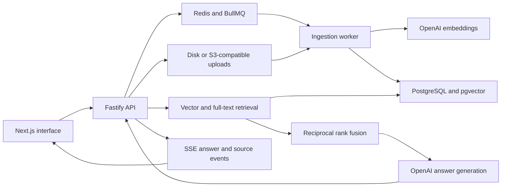

# DocQA

Upload a PDF or text document, ask a question, and inspect the passages behind the streamed answer. DocQA demonstrates the backend work around a retrieval-augmented generation application: ingestion, search, streaming, persistence, and evaluation.

[Web app](https://docqa-web.vercel.app/) · [Two-minute walkthrough](docs/SHOWCASE.md) · [Setup and technical reference](docs/TECHNICAL_GUIDE.md)

## Try the workflow

1. Sign in using the demonstration credentials shown by the app.
2. Upload a small, non-sensitive PDF with selectable text, or a `.txt` or `.md` file.
3. Wait until the document is ready.
4. Ask a question with an answer in the document.
5. Open a numbered citation and compare the answer with its source passage.

Questions search the signed-in user's ready documents, not just the most recently uploaded file. Document text and questions are sent to OpenAI. Scanned PDFs without extractable text require OCR, which is not implemented.

## Architecture

## Engineering highlights

- **Asynchronous ingestion:** parsing, chunking, embedding, retries, and checkpoint resume run outside the upload request.
- **Hybrid retrieval:** up to 20 vector matches and 20 full-text matches are combined with reciprocal rank fusion; the top eight chunks supply context.
- **Inspectable answers:** streamed responses include citation controls that expose the retrieved passages. Citation numbering does not prove factual correctness.
- **Operational controls:** Redis-backed caching and per-user rate limiting, persistent conversations, and ingestion status reporting.
- **Evaluation tooling:** a 30-question fixture set measures retrieval hit@8, with optional model-based answer-faithfulness scoring.

## What the evaluation measures

Hit@8 counts whether any retrieved chunk contains a gold-answer substring. It does not measure complete answer accuracy or validate the entire upload pipeline. The current harness fails below 0.70; optional faithfulness scoring is reported separately.

No fresh result is claimed here. The evaluation workflow requires service credentials and setup; the current CI file does not create the root `.env` consumed by the script or run database migrations. Resolve those prerequisites before describing it as a working CI quality gate.

## Run and inspect

Use Node.js 22 and pnpm 9.15.0. You need PostgreSQL with pgvector, Redis, model credentials, and storage shared by the API and worker. Follow the [technical guide](docs/TECHNICAL_GUIDE.md#run) for configuration, package builds, migration, seeding, and startup. There is no checked-in Docker Compose stack.

| Area | Source |
| --- | --- |
| UI workflow | [page.tsx](apps/web/app/page.tsx) |
| Upload processing | [pipeline.ts](apps/worker/src/pipeline.ts) |
| Hybrid search | [retrieval.ts](apps/api/src/retrieval.ts) |
| Evaluation | [run.ts](apps/api/src/eval/run.ts) |
| Contracts | [shared package](packages/shared/src/index.ts) |

## Boundaries

This is a portfolio application, with username/password demonstration accounts and no registration or password reset. It has no OCR or document-specific chat filter. Retrieval can miss evidence; cited answers still need checking. Some automated tests substitute external dependencies and do not replace a live integration test.

The [technical guide](docs/TECHNICAL_GUIDE.md) preserves detailed setup instructions, API routes, deployment considerations, and known limitations.

Built by [Mustafa Alhasson](https://github.com/pascalmmk) · [LinkedIn](https://www.linkedin.com/in/mustafa-alhasson-11996b437/)
